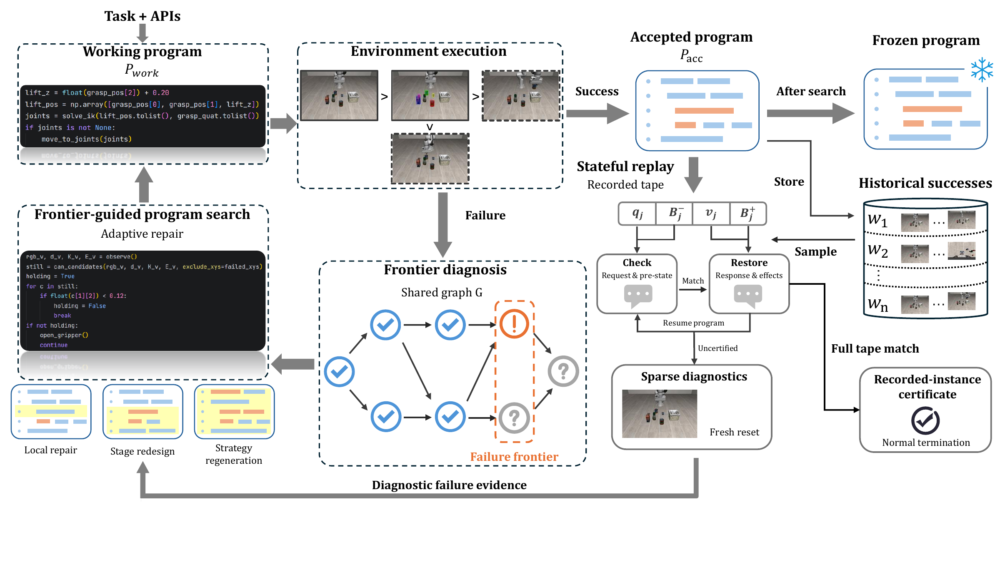

# SCOPE

SCOPE generates and improves robot programs through execution, diagnosis, and repair. Given a task instruction, an initial scene observation, and robot perception and control APIs, a vision-language model produces a working program. SCOPE then uses execution evidence to guide repairs and checks updated programs against recorded successful experience.

The method combines **frontier-guided program search** with **stateful offline replay**. The former identifies where observable task progress breaks down and guides the scope of a repair; the latter checks whether an updated program matches historical successful executions at the recorded API boundary.

## Overview

[](Overview.pdf)

*SCOPE's search and replay workflow. Click the figure to open the original PDF.*

1. **Generate and execute a working program.** SCOPE runs the generated Python program in the simulator and records API interactions, visual observations, and the execution outcome. Program versions are stored alongside their evidence so that later diagnoses and changes can be traced back to a specific run.
2. **Diagnose the failure frontier.** A shared diagnostic graph represents observable task checks and their prerequisites. The critic uses execution evidence to label checks as supported, contradicted, or unknown, then identifies the frontier where supported progress gives way to unresolved checks. Unknown labels can reflect missing evidence; diagnoses remain hypotheses grounded in the available observations.
3. **Choose the scope of repair.** The repair planner considers the frontier, execution traces, and search history. It can make a **local repair** to a condition, parameter, or code fragment; **redesign a stage** and its prerequisites; or **regenerate the strategy** when the overall control flow needs to change. The revised working program is executed again.
4. **Retain successes and replay updated programs.** Successful search executions update the accepted program and populate an archive of historical successes. When the accepted source changes, SCOPE samples earlier successes and checks the updated program against their recorded API tapes. Each replay step checks the request and public pre-call state, restores the recorded response and effects, and resumes program execution.
5. **Collect additional evidence and freeze the result.** A complete tape match with normal termination yields a recorded-instance certificate. Uncertified cases can trigger a limited number of fresh simulator runs; observed failures supply evidence for further repair. When the search completes, SCOPE exports the accepted program as the frozen result.

Replay runs offline using recorded API behavior. Its certificate applies to the **recorded execution instance**, under the declared boundary and runtime assumptions; it does not establish success on a fresh reset, even with the same seed. Replay divergence or unavailability is not itself an observed task failure.

This repository provides a single-task LIBERO-Pro demo of the workflow. The quick start below covers environment setup, service startup, program execution, and inspection of the results.

## Setup

Use Linux, Python 3.12, and an NVIDIA GPU, with CUDA-capable PyTorch and EGL support for headless rendering. The [setup guide](docs/setup.md) covers creating the Python environment, installing dependencies, downloading benchmark assets and model weights, and configuring local paths.

The setup includes LIBERO-Pro simulation dependencies, SAM 3 for segmentation, Contact-GraspNet for grasp proposals, and PyRoKi for inverse kinematics. Source dependencies, benchmark data, and model weights are downloaded separately during setup. Run the commands below from the project root after creating the environment at `.venv/`.

Create a local environment configuration from the provided template:

```bash
cp .env.example .env
```

Fill in `OPENAI_BASE_URL`, `OPENAI_API_KEY`, and `SCOPE_AGENT_MODEL` for a vision-capable Chat Completions model. The model receives task instructions and visual execution evidence and produces the programs and diagnoses used by SCOPE. All values in the template are initially empty.

Set `LIBERO_CONFIG_PATH` to the directory containing the generated LIBERO configuration. Set `SAM3_CHECKPOINT_PATH`, `CONTACT_GRASPNET_ROOT`, and `CONTACT_GRASPNET_CHECKPOINT_DIR` to the corresponding downloaded files and directories, using the paths described in the setup guide. Paths in `.env` should be absolute. The service port variables can remain empty to use their defaults.

## Quick Start

The demo runs **“open the middle drawer of the cabinet”** with these defaults:

| Setting | Default |
| --- | --- |
| Task suite | `libero_goal_swap` |
| Task | `open_the_middle_drawer_of_the_cabinet` |
| Seed | `51` |
| Search actions per invocation | `8` |
| Output directory | `outputs/demo/` |

The task is fixed in the demo entry point. Use `--seed` to select a seed from `51` through `65`, and `--max-actions` to change the invocation's search budget. A search action is an execution, diagnosis, repair, or replay.

Start the perception and inverse-kinematics services in one terminal:

```bash
.venv/bin/python scripts/start_services.py --env-file .env --gpu 0
```

This starts SAM 3 and Contact-GraspNet on the selected GPU and PyRoKi on CPU. Service logs are written to `logs/`. Keep this terminal running while using SCOPE, and allow the models to finish loading before starting the task.

In another terminal, start SCOPE:

```bash
.venv/bin/python scripts/demo.py --env-file .env --gpu 0
```

SCOPE loads the task, captures its initial observation, and generates the first program. It then executes and revises programs using the recorded observations and diagnostic feedback. The terminal reports progress through these steps as the run advances.

## Outputs

Programs, execution videos, diagnostics, and `summary.md` are saved in `outputs/demo/`. Start with `summary.md` to review the current search status and recorded attempts. The saved program files show the initial and subsequent revisions, while the execution videos and traces provide context for the corresponding outcomes.

Once the search completes, `frozen.json` contains the accepted program and its identity metadata. Reaching the per-invocation action limit can stop a run before this export is produced. A frozen result is not by itself evidence of task success, so inspect the recorded outcomes in the summary.

Add `--resume` to the same command to continue a run from its saved state. To start a separate run, use a different output directory, such as `--output outputs/run-2`. The [setup guide](docs/setup.md) also describes the seed, search-budget, and model options.

